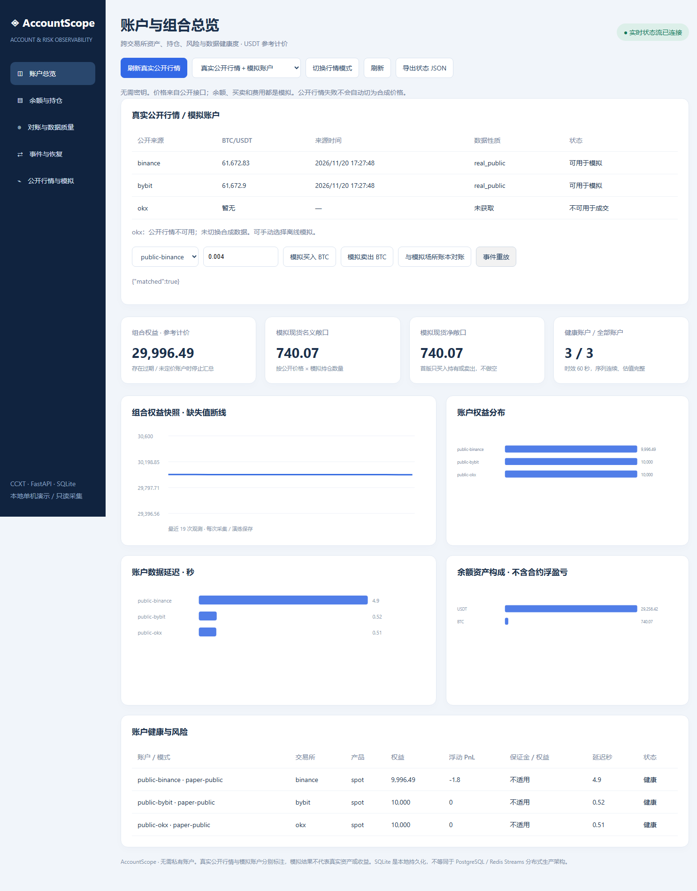
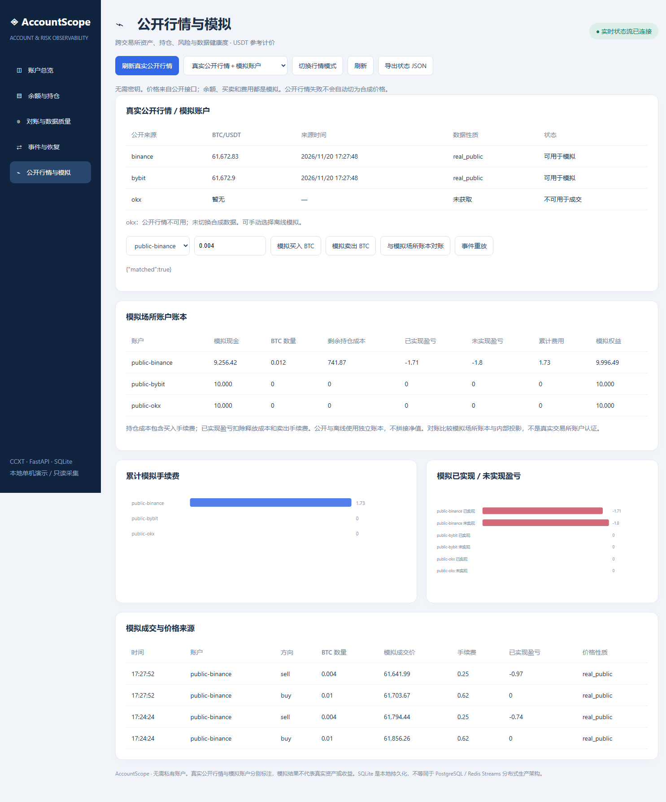

# AccountScope

无需私有账户的公开行情与模拟账户监控平台。默认从 Binance、Bybit、OKX 公共接口获取 BTC/USDT 报价，用于本地模拟账户估值与模拟买卖。不要求注册交易所账户、填写 API Key 或配置 profiles.json。

**真实的是公开价格；余额、持仓、成交、手续费和盈亏都是本地模拟。** 不发送真实订单或转账。



## Render 免费面试演示

[](https://render.com/deploy?repo=https://github.com/duoduohappy/accountscope)

仓库的 render.yaml 仅定义一个 **plan: free** 的 Python Web Service，不包含数据库、磁盘、后台 Worker 或任何付费资源。你也可以在 Render 选择 New → Web Service，连接本仓库并手动填写：

| 设置 | 值 |
| --- | --- |
| Branch | main |
| Runtime / Language | Python 3 |
| Root Directory | 留空 |
| Build Command | `pip install -r requirements-render.txt` |
| Start Command | `uvicorn app:app --host 0.0.0.0 --port $PORT --workers 1` |
| Instance Type | **Free** |
| Health Check Path | `/healthz` |

手动创建时添加以下普通环境变量（均不是密钥）：

```text
ACCOUNTSCOPE_HOSTED_DEMO=1
ACCOUNTSCOPE_EPHEMERAL=1
ACCOUNTSCOPE_PUBLIC_AUTO=1
ACCOUNTSCOPE_DB=/tmp/accountscope/accounts.sqlite3
```

Python 小版本由仓库 .python-version 指定为 3.11。无需添加交易所 API Key，也不创建 Postgres 或挂载磁盘。如果 Render 要求选择收费实例、添加付费资源或付款，请停止，不要升级。

这是公开共享模拟空间：所有访客看见同一组模拟账户，操作会影响同一演示。云端模式屏蔽私有账户采集，并限制共享写操作频率。HTTPS 与 WebSocket Origin 校验已适配反向代理。没有真实资金或私有账户信息，不需要站点管理密钥。

**免费实例会休眠；首次唤醒可能需要等待，重启、重新部署或休眠可能清空 SQLite 模拟记录。** 不将其称为持久化部署，重要演示结果请导出。公开行情受网络及所在地区影响，无法连接时可明确切换合成离线模式继续演示；两种模式的账本相互隔离。

官方依据：[免费实例限制](https://render.com/docs/free)、[FastAPI 部署](https://render.com/docs/deploy-fastapi)。

## 启动

Python 3.10+，Windows：

```powershell
python -m venv .venv
.\.venv\Scripts\python.exe -m pip install -r requirements.txt
.\.venv\Scripts\python.exe -m uvicorn app:app --host 127.0.0.1 --port 8930
```

浏览器打开 http://127.0.0.1:8930/ 。当前工作区依赖已安装，也可双击 start.bat。服务启动后每 15 秒请求公开行情；页面通过内部 WebSocket 每 2 秒更新。

## 无需密钥的业务闭环

1. 默认「真实公开行情＋模拟账户」，每个模拟场所初始化 10,000 USDT，独立记录账户。
2. 页面显示价格、交易所来源时间、数据性质和可用状态。报价超过 60 秒则不能用于成交；持仓估值的有效期按报价时间计算，不能仅靠刷新账户时间延长。
3. 选择模拟账户和 BTC 数量，点击「模拟买入 / 模拟卖出」。只能使用该场所的新鲜报价，不会偷偷借用其他场所的价格。当前不做空。
4. 模拟成交按公开最新成交价加每侧 0.05% 滑点，收取名义金额 0.1% 手续费。它是研究假设，不是盘口撮合或真实成交承诺。
5. 查看现金、数量、含买入费的剩余持仓成本、已实现 / 未实现盈亏、模拟手续费与权益。已实现盈亏扣除释放成本和卖出手续费，费用不会重复扣除。
6. 对照模拟场所账本与内部账户投影，显示差异；从接受事件重放，核对内部状态；导出包含价格来源、成交和账本的 JSON。
7. 在「对账与数据质量」演练重复事件、序列缺口、投影错误、过期和快照恢复。这些操作只作用于当前模拟空间，故障注入有审计记录。



## 公开行情不可用时

单个来源失败会单独提示，其他来源继续工作；不会把合成价格冒充真实行情。无新鲜报价的场所拒绝模拟成交。有持仓但估值过期时，停止组合权益与敞口汇总。

可手动切换「合成离线行情＋独立模拟账户」。该模式完全不请求外网，可验证买卖、费用、对账与恢复。**公开与离线有独立资金、持仓、成交和历史快照，不拼接收益。** 网络恢复后可切回公开空间继续原账户。

空仓只有 USDT 参考现金时，不需要 BTC 报价也可确认现金数值；行情状态与账户现金状态分开显示。USDT 是参考计价单位，不保证它与美元始终等价。

## 首版实现与范围

| 功能 | 当前实现 |
| --- | --- |
| 无凭据公开行情 | Binance 24h ticker、Bybit spot ticker、OKX market ticker，检查标的与来源时间，保存报价记录 |
| 模拟场所 | SQLite 持久化现金、现货库存、成本、手续费、已实现盈亏和成交幂等编号 |
| 内部账户投影 | Decimal 十进制金额、完整快照 / 绝对值补丁、重复去重、内容冲突、旧序号拒绝、缺口阻断 |
| 风险与组合 | 模拟现货名义敞口、余额构成、权益历史、行情 / 账户时效、BTC 集中度超过权益 70% 时告警 |
| 对账与恢复 | 模拟场所账本与内部投影比较、故障审计、完整快照恢复、接受事件重放 |
| 可视化 | 公开价格表、账户权益、资产分布、延迟、持仓成本、费用、盈亏与成交明细，手机导航 |
| 接口 | FastAPI、内部 WebSocket 状态推送、JSON 导出 |

目前没有真实账户余额或交易所私有资金流水。模拟对账能验证两个本地组件的一致性，不能证明真实交易所账务正确。已实现与未实现 PnL 属于模拟现货账本；资金费、杠杆保证金、期权 Greeks 及自动降仓仍未实现。

价格是公开最新成交价，不是可保证成交的买卖报价。不处理真实盘口容量、部分成交、最小交易额、交易所数量精度、冲击成本或排队。当前只模拟 BTC/USDT 现货，不据此宣称覆盖全部产品。

## 数据与运行

runtime/ 保存 SQLite 的规范化事件、账户投影、公开报价、模拟场所账本、成交、对账及快照。默认不提交这些数据，也不把虚拟环境、密钥或 profiles.json 放入源码包。

可通过环境变量 ACCOUNTSCOPE_DB 指定独立数据库。只用一个 Uvicorn worker，避免重复调度。当前是本地单进程工程原型，尚未部署 PostgreSQL、Redis Streams 或 Kafka，不声明生产 SLA。仅绑定 127.0.0.1；没有多用户鉴权，不直接作为公网服务。

## 开源复用与数据依据

- 公开采集使用 Requests 异步线程包装和交易所官方公共 REST 接口，**没有密钥参数**。
- 保留 CCXT 4.5.93 的可选只读适配器，但默认公开 / 模拟路径不使用私有客户端，不要求任何账户配置。CCXT 使用 MIT 许可证：https://github.com/ccxt/ccxt/blob/master/LICENSE.txt 。未复制其 SDK 源码或声称复用其台账。
- Hummingbot API 账户模块经评估依赖连接器、交易服务及 Gateway，未直接复制；NautilusTrader 仅用于对账架构参考，未复制源码。
- Binance 官方公共接口说明：https://github.com/binance/binance-spot-api-docs/blob/master/faqs/market_data_only.md
- Bybit ticker：https://bybit-exchange.github.io/docs/v5/market/tickers
- OKX Market Data：https://www.okx.com/docs-v5/en/#order-book-trading-market-data-get-ticker

## 验证

```powershell
.\.venv\Scripts\python.exe -m unittest -v
.\.venv\Scripts\python.exe benchmark.py
```

26 项核心和 HTTP / WebSocket 测试通过。覆盖资金守恒、费用成本、部分卖出盈亏、重复委托不重复扣费、库存与资金约束、旧报价拒绝、来源时间约束、公开失败不切合成、模式隔离、故障对账及重启恢复。

已在本机实际取得 Binance、Bybit 公开报价，并用真实报价完成模拟买入、卖出、对账与重放；OKX 本次连接失败，界面如实标记不可用，不代表该接口永久不可用。Playwright 验证了公开 / 离线切换、两种独立账本、故障演练、图表、重放及手机端导航。后续接口可用性取决于网络与数据源，不把一次成功当作持续运行证明。

